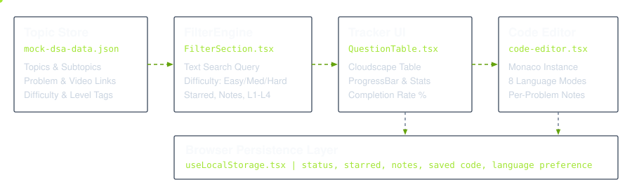

<div align="center">
  
</div>

A TypeScript and React workspace for tracking Data Structures &amp; Algorithms (DSA) practice, organizing problems by topic and subtopic, filtering by difficulty and revision state, and writing solutions in an embedded Monaco code editor with local persistence.

---

## Architecture &amp; Data Flow

<div align="center">
  
</div>

---

## Features

- **Topic &amp; Subtopic Hierarchy**: Organizes DSA questions by topic and subtopic (`TopicSection`, `SubtopicSection`, `QuestionTable`) backed by structured JSON (`basic-vite/src/data/mock-dsa-data.json`).
- **Multi-Facet Filtering**: Filter problems in real time by search text, starred status, difficulty (`Easy`, `Medium`, `Hard`), notes presence, and level (`L1`–`L4`) via `FilterSection`.
- **Embedded Monaco Code Editor**: Built-in `EnhancedCodeEditor` (`basic-vite/src/pages/dashboard/code-editor.tsx`) supporting JavaScript, Python, Java, C/C++, C#, TypeScript, Go, and Other, with automatic layout resizing and language preference persistence.
- **Progress &amp; Statistics**: `StatisticsBlock` and `ProgressBar` track completed questions, total questions, starred items, and overall completion percentage.
- **Client-Side Persistence**: `useLocalStorage` persists problem completion status, starred flags, personal notes, code snippets, and selected editor language across sessions.
- **Cloudscape Design System**: Built on `@cloudscape-design/components` with React Router (`HashRouter` / `BrowserRouter`) and Vite 5.

---

## Repository Structure

```text
DSA/
├── basic-vite/                        # Primary DSA tracker & Monaco workspace
│   ├── src/
│   │   ├── components/                # FilterSection, QuestionTable, ProgressBar, TopicSection
│   │   ├── pages/dashboard/           # DashboardPage, EnhancedCodeEditor, StatisticsBlock
│   │   ├── pages/section1/            # All items, add item, and item detail views
│   │   ├── data/mock-dsa-data.json    # Sample topics, subtopics, and problem metadata
│   │   └── common/                    # Types, constants, API client, storage helpers
│   └── package.json
├── chat-ui-vite/                      # Cloudscape chat UI starter template
├── fullstack-vite-cdk-cognito-auth/   # Fullstack Vite + AWS CDK + Cognito template
├── full-stack-chat-ui-cognito-auth/   # Fullstack Chat UI + AWS CDK + Cognito template
├── assets/                            # Reference template screenshots
├── CONTRIBUTING.md
├── CODE_OF_CONDUCT.md
└── LICENSE                            # MIT No Attribution
```

---

## Getting Started

### Prerequisites

- Node.js 18+ and npm

### Run the DSA Workspace (`basic-vite`)

1. Clone the repository:
   ```bash
   git clone https://github.com/prth1234/DSA.git
   cd DSA/basic-vite
   ```

2. Install dependencies:
   ```bash
   npm install
   ```

3. Start the Vite development server:
   ```bash
   npm run dev
   ```

### Available Scripts (`basic-vite`)

| Script | Command | Description |
| :--- | :--- | :--- |
| Dev server | `npm run dev` | Start Vite local development server |
| Type-check &amp; build | `npm run build` | Run `tsc` and build production bundle with Vite |
| Preview | `npm run preview` | Preview production build locally |
| Lint | `npm run lint` | Run ESLint across `.ts` and `.tsx` files |
| Format | `npm run format` | Format source files with Prettier |

---

## Contributing &amp; License

See [CONTRIBUTING.md](CONTRIBUTING.md) and [CODE_OF_CONDUCT.md](CODE_OF_CONDUCT.md) for contribution guidelines.

Licensed under the [MIT No Attribution License](LICENSE).
